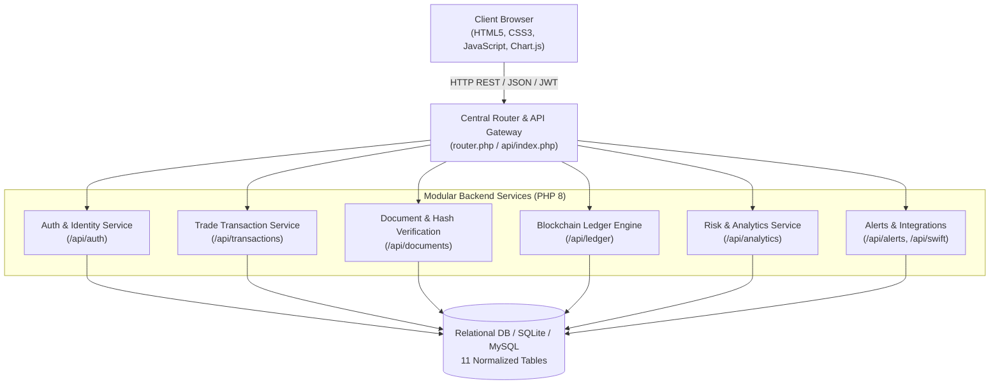

# PROJECT REPORT: TRADE FINANCE BLOCKCHAIN EXPLORER (CHAINDOCS)

---

## 1. Executive Summary & Project Purpose

### What is this Application?
**ChainDocs (Trade Finance Blockchain Explorer)** is an enterprise-grade financial technology web application designed to solve critical vulnerabilities in global trade finance:
- **Paper-heavy document forgery** (bills of lading, invoices, Letters of Credit).
- **Double-financing fraud** (submitting the exact same trade document or bill to multiple banks for duplicate credit).
- **Lack of cross-party transparency** between buyers, sellers, financing banks, and independent regulatory auditors.

By pairing modern **PHP REST APIs & Microservice-oriented architecture** with an **append-only cryptographic hash-linked ledger (blockchain simulation)**, ChainDocs provides an immutable audit trail and real-time verification of trade assets.

---

## 2. Technical Stack & Architecture



### Technology Breakdown
| Layer | Technologies Used | Description |
| :--- | :--- | :--- |
| **Frontend** | HTML5, CSS3, Vanilla JavaScript, Chart.js | Responsive multi-page web application with client-side form validations, dynamic DOM manipulation, and financial analytics charts. |
| **Server / Routing** | PHP 8.x, `router.php`, Built-in Web Server | Custom router acting as an API reverse proxy / static asset dispatcher. |
| **API Gateway & Microservices** | PHP RESTful API Dispatcher, JWT (`HMAC-SHA256`) | Centralized API Gateway delegating requests into modular domain services with Role-Based Access Control (RBAC). |
| **Cryptography & Blockchain** | SHA-256 Hashing, Parent-Hash Chaining | Generates cryptographic document fingerprints and constructs an immutable append-only ledger block sequence (`previous_hash` &rarr; `entry_hash`). |
| **Database** | SQLite 3 / MySQL (compatible with XAMPP / PDO) | 11 relational tables enforcing foreign keys, transactions, and audit constraints. |
| **Version Control** | Git & GitHub | Public repository tracked on GitHub: [blockchain-tradefinance-explorer](https://github.com/RaghuramSRM/blockchain-tradefinance-explorer). |

---

## 3. Core Modules & Functionalities

### 3.1 Authentication & Role-Based Access Control (RBAC)
Supports 4 institutional personas:
1. **`ADMIN`**: Global system governance, organizational setup, and oversight.
2. **`BANK`**: Financing institute; reviews transactions, approves credit limits, and validates Letters of Credit.
3. **`CORPORATE`**: Importers/exporters; initiates trade deals, uploads shipping invoices, and signs bills of lading.
4. **`AUDITOR`**: Read-only oversight; verifies ledger block hashes, inspects discrepancies, and checks compliance.

### 3.2 Trade Transaction Lifecycle (State Machine)
Trades progress through a strict finite state machine:
- **`PENDING`**: Created by an importer/exporter with counterparty details, contract currency, and commodity values.
- **`IN_PROGRESS`**: Approved by the financing bank after risk and compliance validation.
- **`COMPLETED`**: Finalized and settled upon successful document verification and shipping delivery.
- **`DISPUTED`**: Raised if counterparty terms are breached or fraudulent documents are detected.

### 3.3 Cryptographic Document Anchoring & Fraud Prevention
1. When an invoice, Letter of Credit, or Bill of Lading is uploaded, the server calculates its **SHA-256 cryptographic checksum**.
2. If another user attempts to upload an identical document across any other trade or organization, the system detects a hash collision and triggers a **Double-Financing Warning**.
3. Users and auditors can upload any file to the **Document Verification Tool** (`frontend/documents.html`) to verify in real-time whether the document has been altered by even 1 byte.

### 3.4 Append-Only Hash-Linked Blockchain Ledger
- Every state transition or document anchor creates a new block entry.
- Each block records:
  - `block_index`: Sequential integer index.
  - `previous_hash`: SHA-256 hash of the immediate preceding block (Genesis block starts with zeros).
  - `entry_hash`: `hash('sha256', previous_hash + tx_id + event_type + timestamp + payload)`.
- If an attacker tampers directly with an earlier block in the database, the hash chain breaks, immediately failing the automated cryptographic integrity check.

### 3.5 Financial Risk & Basel III Compliance Dashboard
- Computes counterparty risk scores based on transaction volume, history, and dispute frequency.
- Visualizes real-time metrics with Chart.js:
  - Total trade volume by currency (USD, EUR, GBP, etc.).
  - Transaction state distributions (Completed vs. Pending vs. Disputed).
  - High-risk counterparty warnings.

---

## 4. Complete Database Schema (11 Tables)

| Table Name | Primary Role | Key Columns |
| :--- | :--- | :--- |
| `organizations` | Institutions participating in the trade network | `id`, `name`, `type` (BANK/CORP/AUDIT), `created_at` |
| `users` | User credentials and RBAC roles | `id`, `name`, `email`, `password_hash`, `role`, `org_id` |
| `organization_members` | Organization mapping & permissions | `id`, `user_id`, `org_id`, `joined_at` |
| `refresh_tokens` | Secure token refresh management | `id`, `user_id`, `token_hash`, `expires_at` |
| `trade_transactions` | Core trade deals, values, and status | `id`, `tx_code`, `importer_id`, `exporter_id`, `bank_id`, `amount`, `currency`, `status` |
| `transaction_history` | Audit trail of all status updates | `id`, `tx_id`, `from_status`, `to_status`, `changed_by`, `timestamp` |
| `documents` | Uploaded trade instruments & hashes | `id`, `tx_id`, `filename`, `file_path`, `sha256_hash`, `uploaded_by` |
| `ledger_entries` | Blockchain blocks | `id`, `block_index`, `previous_hash`, `entry_hash`, `event_type`, `payload`, `created_at` |
| `alerts` | Actionable user notifications | `id`, `user_id`, `title`, `message`, `type`, `is_read`, `created_at` |
| `risk_scores` | Basel III counterparty scores | `id`, `org_id`, `score`, `risk_level`, `assessed_at` |
| `audit_logs` | Immutable audit entries | `id`, `action`, `actor_id`, `ip_address`, `timestamp` |

---

## 5. API Endpoint Specifications

All endpoints communicate via standard JSON payloads and return appropriate HTTP status codes:

### Auth Endpoints
- `POST /api/auth/register` &mdash; Registers a new user, hashes password using `password_hash(PASSWORD_BCRYPT)`, creates initial organization.
- `POST /api/auth/login` &mdash; Validates credentials and returns an HMAC-SHA256 JWT access token.
- `GET /api/auth/me` &mdash; Returns authenticated user profile and permissions.

### Trade Transaction Endpoints
- `GET /api/transactions` &mdash; Retrieves trade transactions filtered by user role/organization.
- `POST /api/transactions` &mdash; Creates a new trade deal (Letter of Credit, Contract).
- `POST /api/transactions/{id}/approve` &mdash; Bank approval transitioning trade from `PENDING` to `IN_PROGRESS`.
- `POST /api/transactions/{id}/complete` &mdash; Completes and settles trade contract.
- `POST /api/transactions/{id}/dispute` &mdash; Flags transaction with dispute reason.

### Document & Ledger Endpoints
- `GET /api/documents` &mdash; Lists all trade documents.
- `POST /api/documents/upload` &mdash; Multipart form file upload; validates file MIME type, calculates SHA-256 hash, checks for duplicates, and creates a ledger entry.
- `POST /api/documents/verify` &mdash; Accepts file hash or file upload and verifies authenticity against ledger records.
- `GET /api/ledger` &mdash; Returns the full chronological block explorer list.
- `GET /api/ledger/validate` &mdash; Traverses from block 0 to the latest block to verify unbroken cryptographic continuity.

### Analytics & System Endpoints
- `GET /api/analytics` &mdash; Returns aggregated volume, dispute rates, and risk scores.
- `GET /api/alerts` &mdash; Returns user notification feed.
- `GET /api/orgs` &mdash; Returns list of active participant institutions.

---

## 6. How to Run the Application Locally

1. **Start the Web Server**:
   Double click `start_server.bat` or run:
   ```powershell
   php -S 127.0.0.1:8000 router.php
   ```
2. **Access the Web Interface**:
   Open browser at: `http://127.0.0.1:8000`
3. **Demo Accounts Provided (Seed Data)**:
   - **Bank Admin:** `bank_admin@globaltrade.com` / `Password123!`
   - **Corporate Importer:** `importer@apexmetals.com` / `Password123!`
   - **Auditor:** `auditor@pwc-audit.com` / `Password123!`

---

## 7. Key Points for Viva & Presentation

1. **Why PHP for Microservices and APIs?**
   - High execution speed, native support for JSON, built-in SQLite/MySQL PDO database drivers, and clean REST routing without heavy dependencies.
2. **How is Blockchain Implemented without Heavy Mining/Gas?**
   - Implements the core cryptographic primitive of blockchain: **SHA-256 linked blocks** where `hash(Block N) = SHA256(Block N-1 Hash + Payload + Timestamp)`. This provides mathematical tamper evidence suitable for private permissioned consortiums.
3. **How Does It Stop Fraud?**
   - Every invoice or document digest is indexed. Attempting to finance the same invoice across multiple banks triggers an immediate cryptographic conflict.
